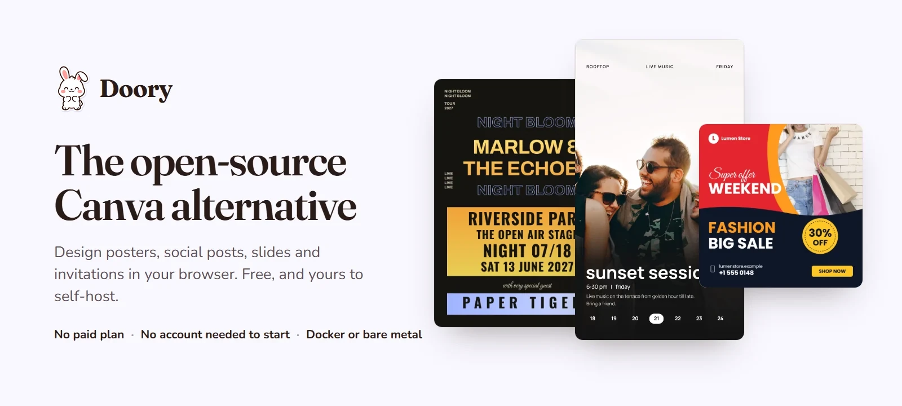
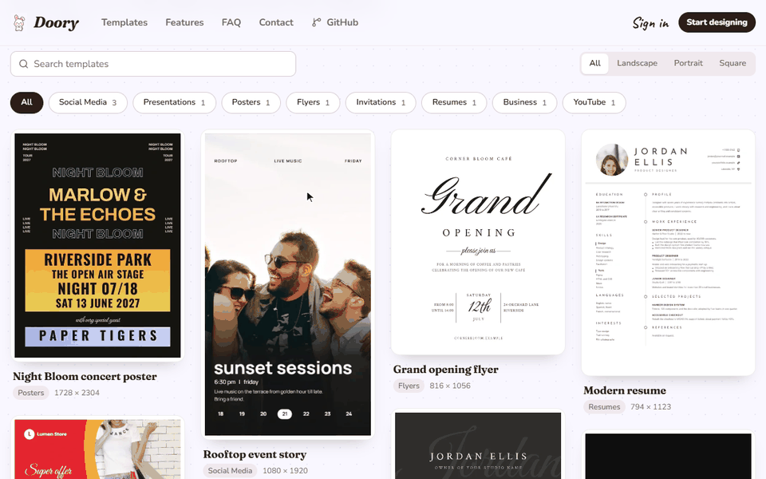
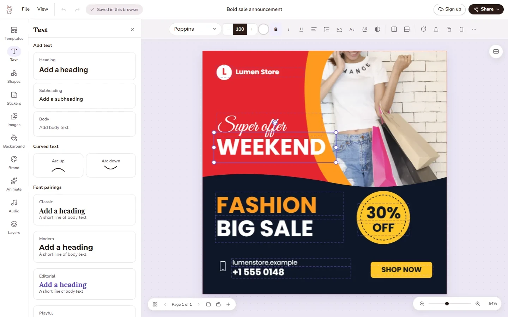
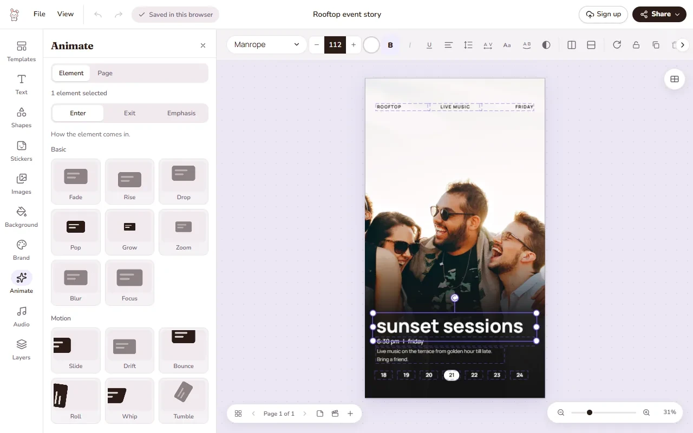
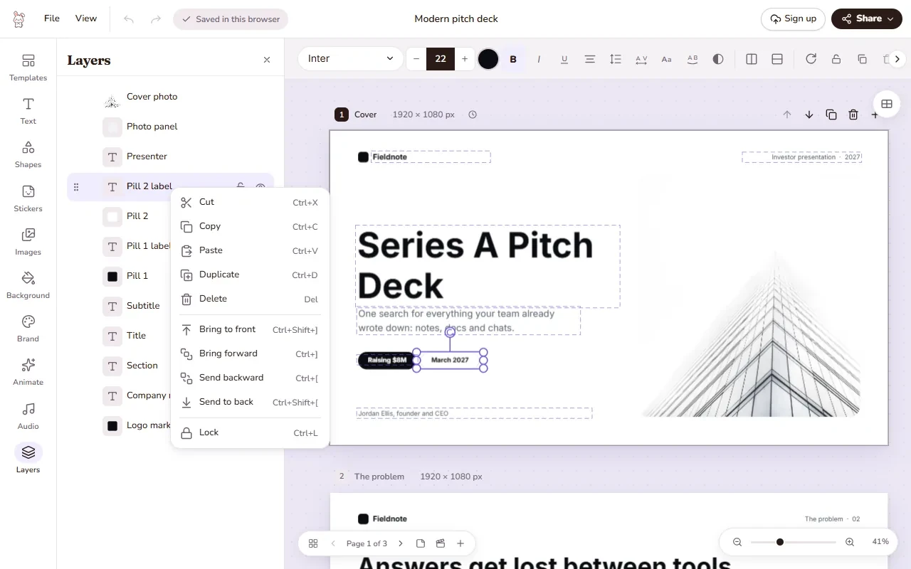
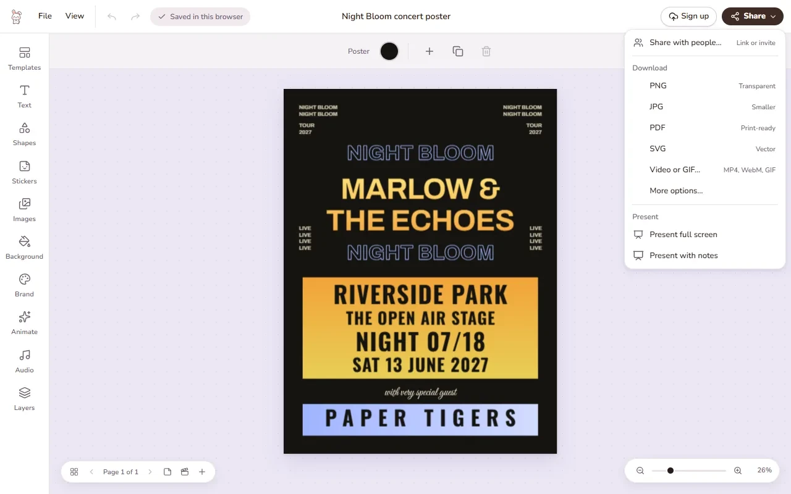
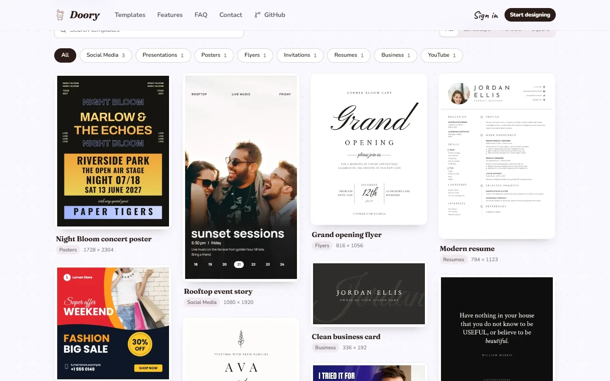

<a href="https://github.com/shaongitbd/doory"></a>

# Doory

Doory is a design editor that runs in the browser: posters, social posts, stories, slides, invitations, resumes,
thumbnails and business cards. You start from a template or a blank page, edit everything on it, and export PNG,
JPG, SVG, PDF, MP4 or GIF. There is no paid plan, you don't need an account to start, and you can run it on your own
server with Docker or without it.

It is a young project: the editor is complete, the template library is small (ten starter templates), and bug
reports are very welcome.

<p align="center">
  
</p>

## What it can do

<table>
  <tr>
    <td width="50%" valign="top">
      
      <b>Editing.</b> Tools sit in a rail on the left and open as panels; the toolbar above the page changes with
      what you select.
    </td>
    <td width="50%" valign="top">
      
      <b>Animation.</b> Enter, exit and emphasis animations, page transitions, music and sound effects. Present it,
      or export it as a video or GIF.
    </td>
  </tr>
  <tr>
    <td width="50%" valign="top">
      
      <b>Layers.</b> Rename, lock, hide, group and reorder anything, or right-click it to copy, duplicate and arrange.
    </td>
    <td width="50%" valign="top">
      
      <b>Share and export.</b> One menu for share links, downloads and presenting. Downloads are made in the
      browser; print PDFs can have bleed and crop marks.
    </td>
  </tr>
</table>

| | |
|---|---|
| **Text** | Headings, curved text, effects, font pairings, lists, an open-licensed font catalogue and your own fonts |
| **Elements** | Shapes, lines and arrows, about 27,500 icons, emoji and illustrations, stickers, QR codes |
| **Photos** | Upload, crop, masks and filters, background removal that runs in the browser, 2×–4× upscaling with a pure-code resampler, stock photo search with an Unsplash or Pexels key |
| **Layout** | Layers, groups, alignment guides, snapping, rulers, several pages per design (each its own size), resize to another format |
| **Motion and sound** | 27 enter and exit animations, 12 emphasis animations, 16 page transitions, 24 music loops and 88 sound effects (CC0), Freesound search with a key (CC0 by default), voiceover recording |
| **Present** | Present mode with speaker notes, timing, auto-advance and a second presenter window |
| **Together** | Share links that view, comment or edit (with an optional password), pinned comments, version history, real-time co-editing |
| **Brand** | Brand kits with your colours, fonts and logos |
| **Export** | PNG, JPG, SVG, PDF, MP4, WebM and GIF |
| **Accessibility** | High-contrast mode with darker text, borders and focus rings, following your device setting or switched in the editor's View menu or in Settings |

## Templates

<p align="center">
  
</p>

Ten starter templates ship with Doory. Each one follows the layout of the best-selling templates in its category,
uses open-licensed fonts and, where it has a photo, a CC0 one. Everything on them can be edited. Admins can add more
in the admin site.

<p align="center">
  
</p>

## Self-host it

```bash
cp .env.example .env     # set DJANGO_SECRET_KEY (openssl rand -base64 48) and POSTGRES_PASSWORD
docker compose up -d --build
docker compose exec api python manage.py createsuperuser   # your admin account; nothing creates one for you
```

Open <http://localhost:8080> and start designing. A new site starts empty, so next add the
[starter content](docs/self-hosting/content.md) (templates, fonts, icons, audio).

The [documentation](docs/README.md) covers the rest:

- [Install with Docker](docs/self-hosting/docker.md) or [without Docker](docs/self-hosting/manual.md) (nginx and systemd)
- [Every setting](docs/self-hosting/configuration.md), [upgrading](docs/self-hosting/upgrading.md), [backups](docs/self-hosting/backup.md) and [troubleshooting](docs/self-hosting/troubleshooting.md)
- Optional: [email](docs/integrations/email.md), [Google sign-in](docs/integrations/google-sign-in.md), [single sign-on (OpenID Connect)](docs/integrations/oidc.md), [S3-compatible storage](docs/integrations/object-storage.md), [stock photos](docs/integrations/stock-media.md), [server-side export](docs/self-hosting/image-export.md)
- [Develop locally](docs/development/README.md): `make setup`, `make dev-api`, `make dev-web`

## Use it from an AI assistant (MCP)

Doory runs a [Model Context Protocol](https://modelcontextprotocol.io) server at `/mcp` on your domain, so Claude,
Cursor and other MCP clients can create and edit your designs: "make a 1080 x 1350 poster for our summer sale with
the brand colours", "translate the headlines on every page", "move the logo to the bottom right".

It's off by default. To turn it on, connect a client and see what assistants can do, read
[docs/self-hosting/mcp.md](docs/self-hosting/mcp.md).

Templates can be filled by field key, from an assistant (`fill_design`, `bulk_fill`) or from the REST API
(`POST /api/v1/designs/{id}/fill/` and `/bulk-fill/`, one new design per row, at most `BULK_FILL_MAX_ROWS`).
On REST each bulk row counts against the `bulk_fill` rate (120/min), and over MCP against `MCP_CALLS_PER_MINUTE`;
each new image URL counts against the `bulk_fill_images` rate (300/min, instead of the upload rate) and each
exported image against the export rate. A row over the limit reports its error and the others go on.
Image values may be public https URLs, which the server copies into your uploads while `URL_IMAGE_UPLOADS` is on
(the default; set it to `false` to turn off URL images for the assistant and the API alike). Many URL images or
exports make one long request, so lower `BULK_FILL_MAX_ROWS` if requests hit the worker timeout.

## FAQ

<details>
<summary><b>Is it really free?</b></summary>
<br />
Yes. Doory has no paid plan, no locked features and no ads.
</details>

<details>
<summary><b>Do I need an account?</b></summary>
<br />
No. Guests design straight away and their work is saved in the browser. An account keeps designs in the cloud,
lets you share them and use brand kits; signing up moves your guest designs over in one step.
</details>

<details>
<summary><b>Can I use it for my business or host it for my users?</b></summary>
<br />
Yes, as long as you credit the author as the licence asks: keep the licence and NOTICE with it and show the
credit in the running app. See <a href="#license-and-credit">License and credit</a>.
</details>

<details>
<summary><b>Where are my designs stored?</b></summary>
<br />
Guest designs and their images live in the browser on that device. Signed-in designs are stored on the server
that runs Doory: yours, if you self-host. Uploads can go to a local volume or to S3-compatible storage.
</details>

## Built with

React 19, TypeScript, Vite, Fabric.js, Yjs and Zustand in the browser; Django 5, Django REST Framework,
Channels and PostgreSQL on the server; Docker Compose with nginx, optional Redis and S3-compatible storage.

## Contributing

Bug reports, ideas and pull requests are welcome. Open an [issue](https://github.com/shaongitbd/doory/issues) to
report a bug or suggest a feature. For a security problem, please report it privately through the repository's
**Security** tab instead. Before opening a pull request, read [CONTRIBUTING.md](CONTRIBUTING.md), including the
rule for updating the docs.

## License and credit

Doory is released under the [Attribution Assurance License](LICENSE). You may use, change and redistribute it,
including commercially, but **you must credit the author**: keep the licence and [NOTICE](NOTICE) with it, and
display this credit prominently in the running app:

> Doory by Siam, creator and maintainer of Doory, https://github.com/shaongitbd/doory

The copyright is held by Siam and the contributors listed in [AUTHORS.md](AUTHORS.md).

The licence text is GPG-signed by Siam, as the licence asks. To check it:
`gpg --import licenses/siam-gpg.asc && gpg --verify LICENSE`. The key's fingerprint is
`3255 3D6C 37CF 387A 36FF D6BB FEB1 0669 1898 A504`, and the same key is published at
https://github.com/shaongitbd.gpg.

Third-party software, fonts and content keep their own licences; see [THIRD_PARTY.md](THIRD_PARTY.md).

<div align="center">
<br />

<br />
<sub>Made with care by Siam and the Doory bunny.</sub>
</div>
